# GameShelf

Aplikasi Flutter untuk menjelajahi katalog game *free-to-play* dari **FreeToGame API** dan mencatat **backlog game pribadi** (*Ingin main*, *Sedang main*, *Selesai*) yang tersimpan di **Supabase**.

> Proyek Ujian Tengah Semester mata kuliah **Pemrograman Mobile**.

## Identitas

| **Nama** | Agus Prasetya |
| **NIM** | 2415051039 |
| **Kelas** | PTI-5B |
| **Program studi** | Pendidikan Teknik Informatika, Universitas Pendidikan Ganesha |
| **Mata kuliah** | Pemrograman Mobile |

## Unduh APK

APK siap pasang tersedia di halaman [**Releases**](../../releases/latest) dengan nama `UTS_2415051039_Agus_Prasetya.apk`.

## Fitur

- **Katalog game (REST API).** Grid responsif dengan filter genre, pencarian judul, dan tarik-untuk-refresh.
- **Detail game.** Deskripsi yang bisa dibuka dengan *Selengkapnya*, screenshot, informasi rilis, dan spesifikasi minimum.
- **Backlog pribadi (CRUD Supabase):**
  - **Create:** form dengan validasi (status, rating bintang, jam main, catatan).
  - **Read:** daftar backlog dengan filter status.
  - **Update:** form yang sama, terisi data lama.
  - **Delete:** dengan dialog konfirmasi.
- **Home.** Jumlah game per status, pilihan game acak dari *Ingin main*, jelajah genre, dan daftar game populer.
- **Profil.** Identitas mahasiswa, statistik backlog (jumlah game dan total jam main), info aplikasi, dan atribusi FreeToGame.
- **Feedback pengguna.** SnackBar (termasuk aksi *Lihat*), dialog konfirmasi, serta tampilan *loading*, *error* (dengan tombol *Coba lagi*), dan *kosong*.
- **Responsif:**
  - NavigationBar di layar < 840 dp, NavigationRail di layar ≥ 840 dp.
  - Grid Katalog 2/3/4 kolom.
  - Detail dua kolom di layar lebar.
  - Tetap rapi dengan ukuran font sistem yang besar.

## Screenshot

<table>
  <tr>
    <td align="center">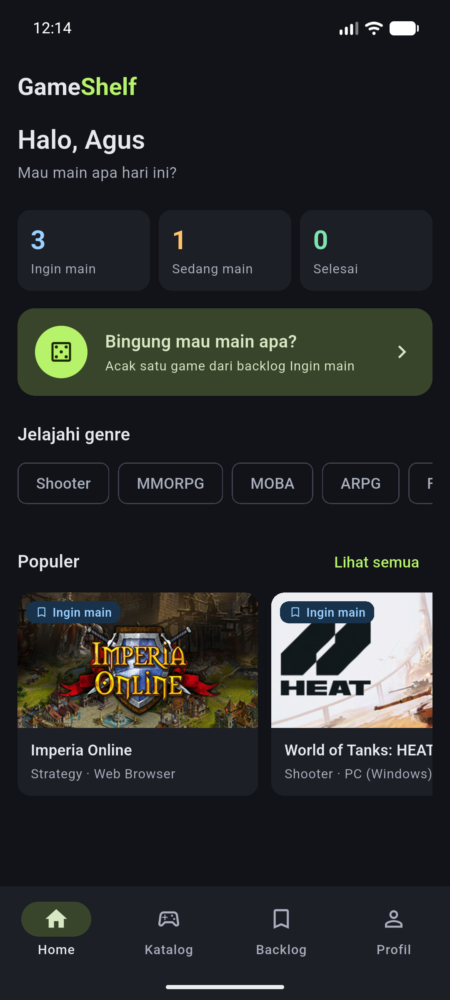<br>Home</td>
    <td align="center">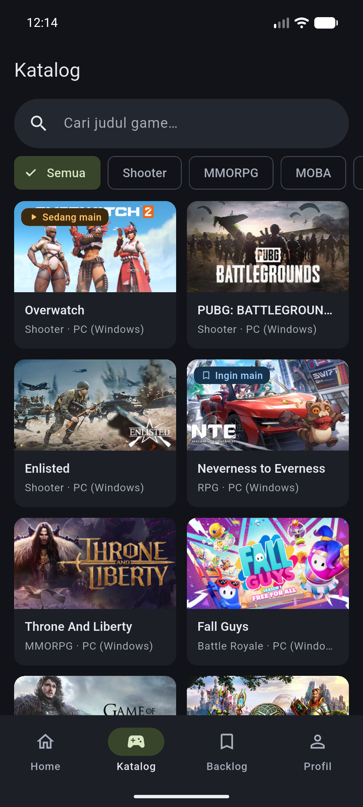<br>Katalog</td>
    <td align="center">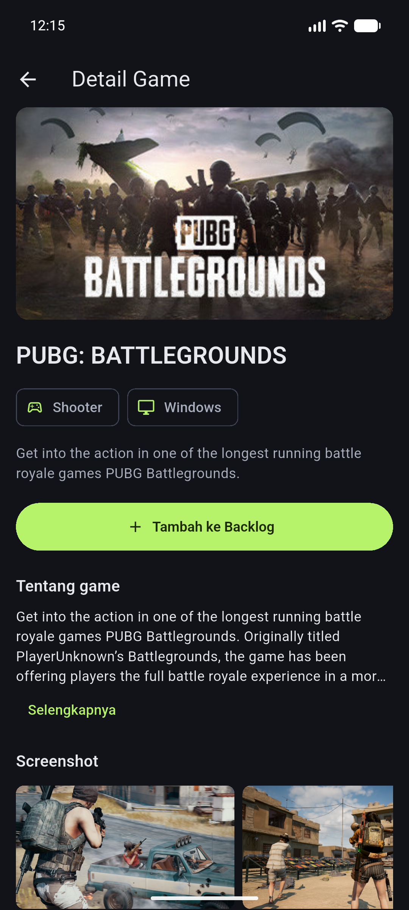<br>Detail game</td>
  </tr>
  <tr>
    <td align="center">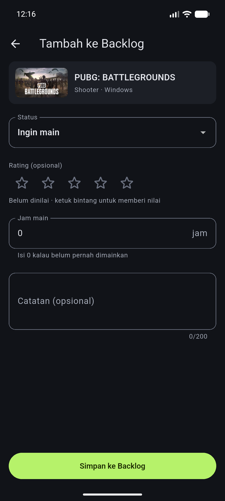<br>Tambah ke backlog</td>
    <td align="center">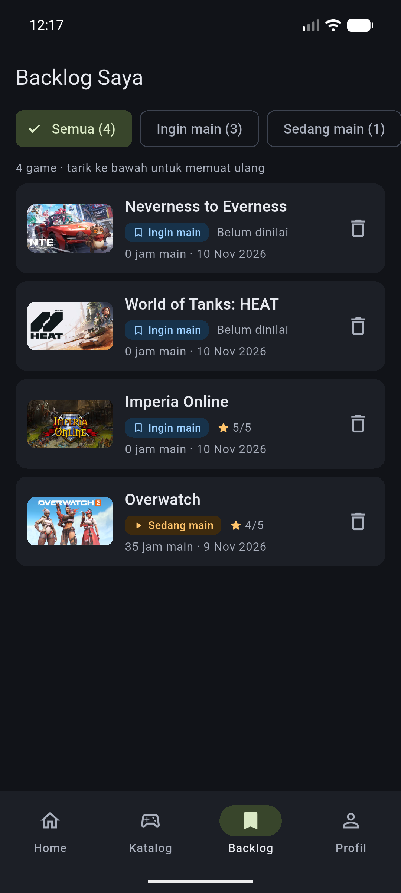<br>Backlog saya</td>
    <td align="center">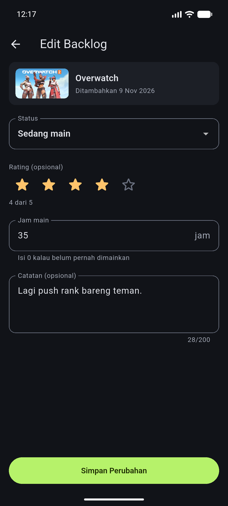<br>Edit backlog</td>
  </tr>
  <tr>
    <td align="center">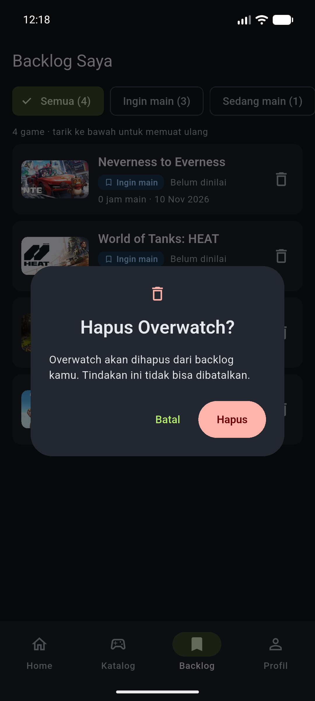<br>Dialog konfirmasi hapus</td>
    <td align="center">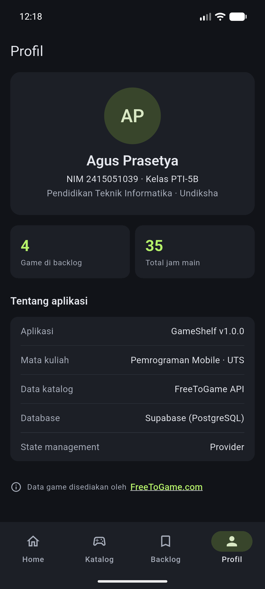<br>Profil</td>
    <td align="center">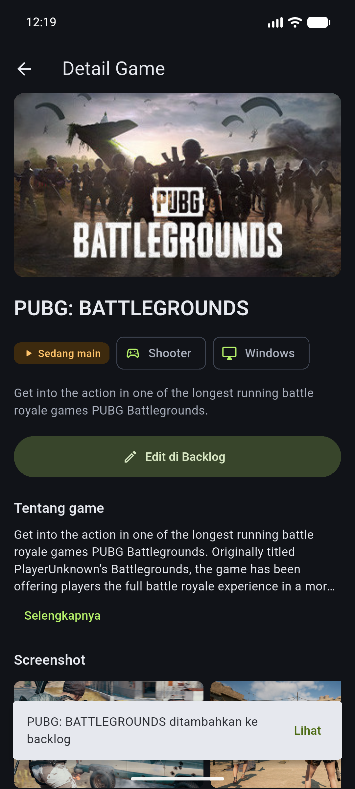<br>SnackBar setelah simpan</td>
  </tr>
  <tr>
    <td align="center">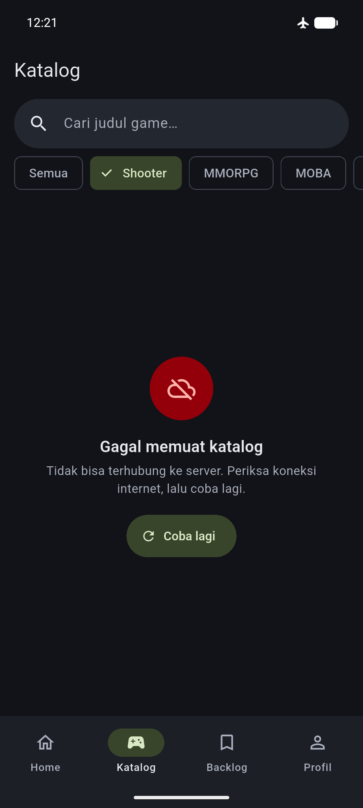<br>State error</td>
    <td align="center">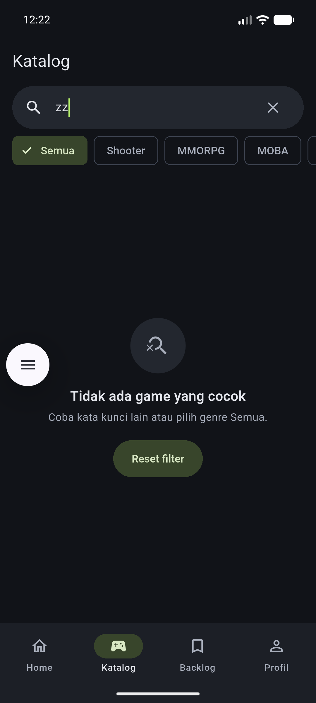<br>State kosong</td>
    <td></td>
  </tr>
</table>

<table>
  <tr>
    <td align="center">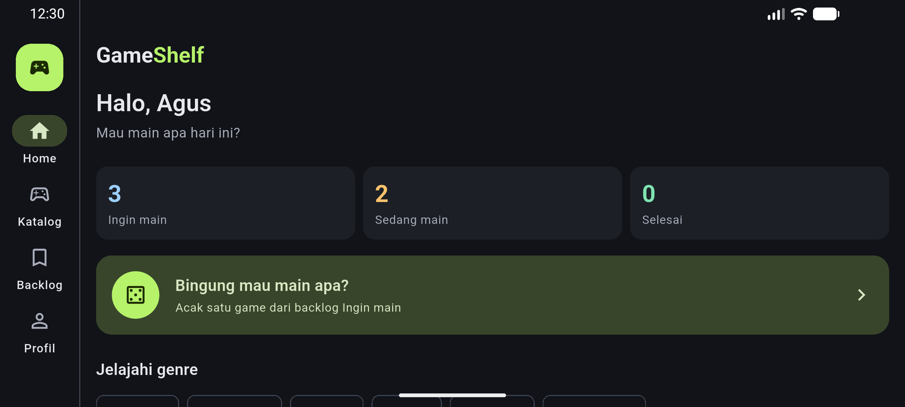<br>Home</td>
    <td align="center">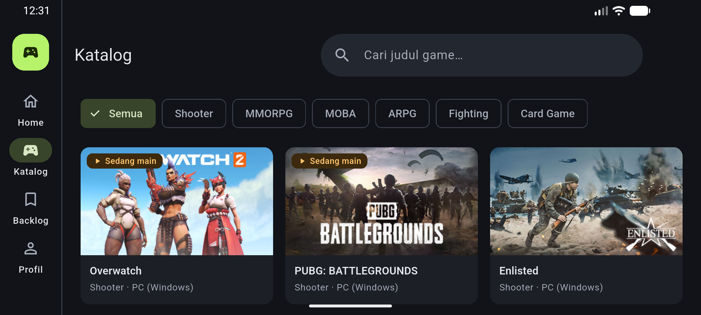<br>Katalog</td>
    <td align="center">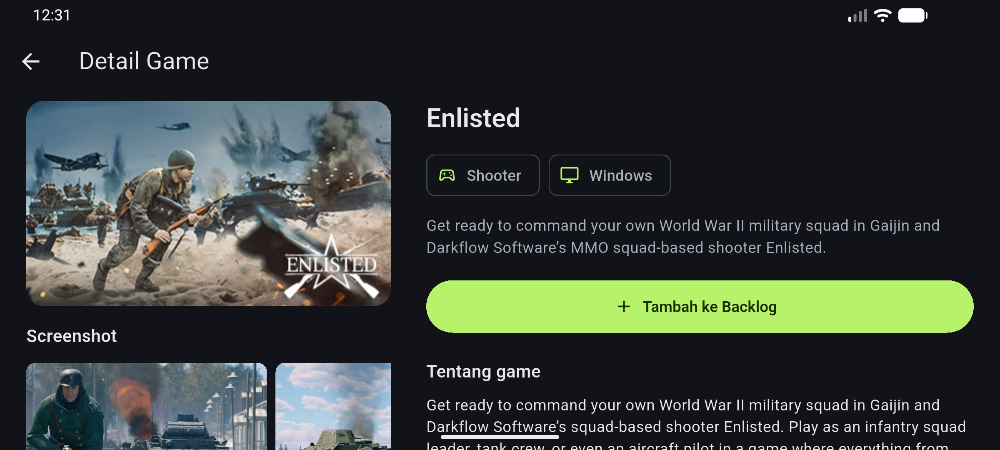<br>Detail game</td>
  </tr>
  <tr>
    <td align="center">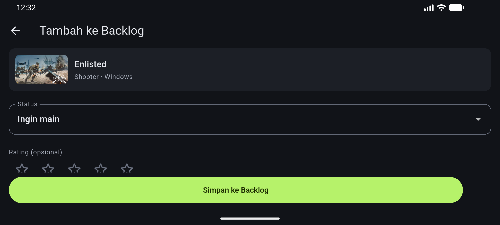<br>Tambah ke backlog</td>
    <td align="center">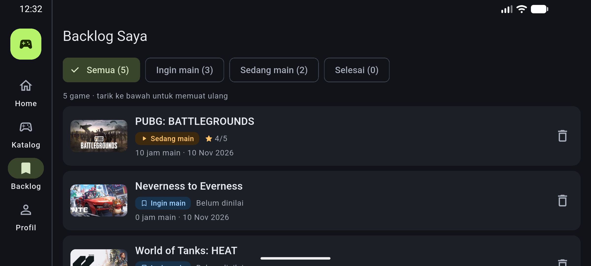<br>Backlog saya</td>
    <td align="center">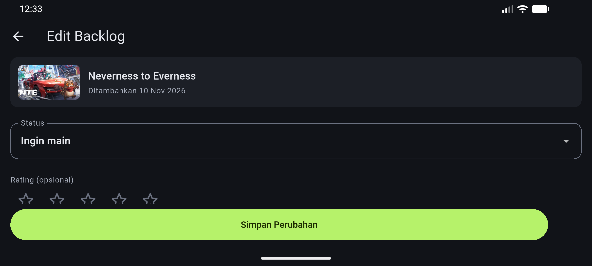<br>Edit backlog</td>
  </tr>
  <tr>
    <td align="center">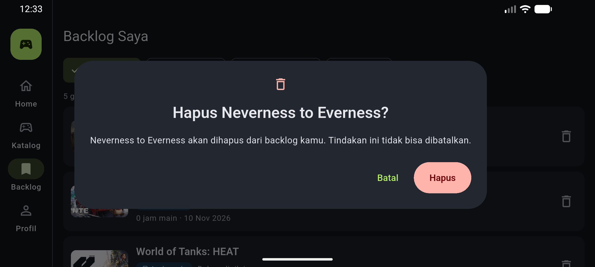<br>Dialog konfirmasi hapus</td>
    <td align="center">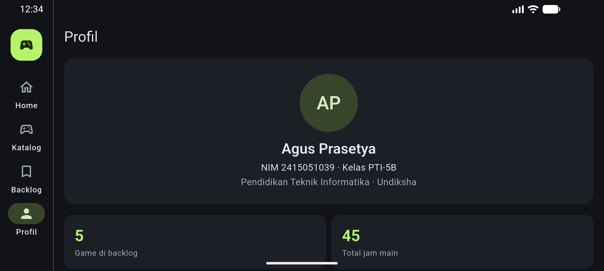<br>Profil</td>
    <td align="center">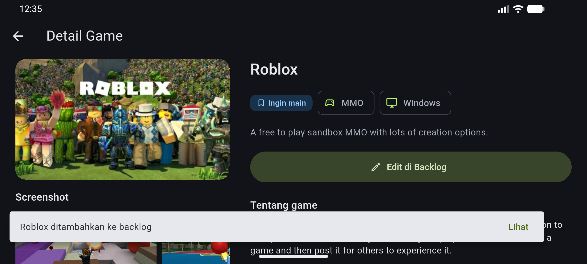<br>SnackBar setelah simpan</td>
  </tr>
  <tr>
    <td align="center">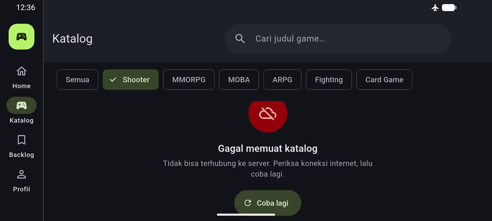<br>State error</td>
    <td align="center">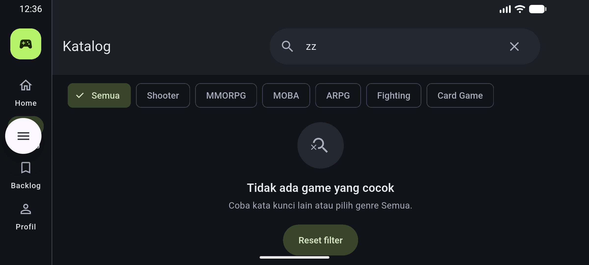<br>State kosong</td>
    <td></td>
  </tr>
</table>

## Teknologi

| Teknologi | Kegunaan |
|---|---|
| Flutter & Dart (Material 3, tema gelap) | Antarmuka aplikasi |
| [`provider`](https://pub.dev/packages/provider) | State management (`ChangeNotifier`) |
| [`http`](https://pub.dev/packages/http) | Mengakses REST API FreeToGame |
| [`supabase_flutter`](https://pub.dev/packages/supabase_flutter) | Database PostgreSQL (CRUD backlog) |
| [`url_launcher`](https://pub.dev/packages/url_launcher) | Membuka tautan atribusi FreeToGame.com |
| `flutter_test` | Unit test dan widget test |
| [`flutter_launcher_icons`](https://pub.dev/packages/flutter_launcher_icons) (dev) | Membuat ikon aplikasi |

## REST API: FreeToGame

Base URL: `https://www.freetogame.com/api`. Semua request memakai metode **GET**.

| Endpoint | Dipakai untuk |
|---|---|
| `/games` | Katalog genre *Semua* |
| `/games?category={kategori}` | Filter genre: `shooter`, `mmorpg`, `moba`, `action-rpg`, `fighting`, `card` |
| `/games?sort-by=popularity` | Bagian *Populer* di Home (10 teratas) |
| `/game?id={id}` | Halaman Detail game |

- **JSON ke model:**
  - `Game.fromJson` (daftar game)
  - `GameDetail.fromJson` (detail, mewarisi `Game`)
  - `SystemRequirements` (spesifikasi minimum; `null` untuk game browser)
- **Penanganan request:**
  - batas waktu 15 detik
  - status selain 2xx diubah menjadi `ApiException`
  - semua error diterjemahkan menjadi pesan yang ramah pengguna
- **Pencarian judul** dilakukan secara lokal di provider, karena FreeToGame tidak menyediakan endpoint pencarian.

## Database: Supabase

Tabel `game_backlog`. Skema lengkap ada di [`docs/supabase_schema.sql`](docs/supabase_schema.sql).

| Kolom | Tipe | Keterangan |
|---|---|---|
| `id` | `uuid` | Primary key, dibuat otomatis |
| `student_id` | `text` | NIM pemilik data |
| `game_id` | `integer` | Id game di FreeToGame; unik per `student_id` |
| `title` | `text` | Judul game |
| `thumbnail` | `text` | URL gambar |
| `status` | `text` | `ingin_main` / `sedang_main` / `selesai` |
| `rating` | `integer` | 0–5 (0 = belum dinilai) |
| `hours_played` | `integer` | Jam main, ≥ 0 |
| `note` | `text` | Catatan, maksimal 200 karakter (dibatasi di form) |
| `created_at` | `timestamptz` | Waktu ditambahkan |

| Operasi | Query (supabase_flutter) | Layar |
|---|---|---|
| Create | `insert(...).select().single()` | Tambah ke Backlog |
| Read | `select().eq('student_id', nim).order('created_at')` | Backlog, Home, Katalog, Detail, Profil |
| Update | `update(...).eq('id', id).select().single()` | Edit Backlog |
| Delete | `delete().eq('id', id)` setelah dialog konfirmasi | Backlog Saya |

- **Row Level Security** aktif.
- Aplikasi hanya memakai **publishable/anon key**. Tidak ada `service_role`/secret key di repositori.

## Arsitektur

```
UI (screens, widgets)
   │  context.watch (membaca state) / context.read (memanggil aksi)
   ▼
Provider (ChangeNotifier)   ← state dan logika tampilan
   ▼
Repository                  ← sumber data untuk provider
   ▼
Service                     ← HTTP ke FreeToGame / query Supabase
   ▼
FreeToGame API · Supabase (PostgreSQL)
```

Screen tidak pernah memanggil HTTP atau database secara langsung.

```
lib/
├── config/        identitas, breakpoint, genre, tab, konfigurasi Supabase
├── models/        Game, GameDetail, BacklogItem, BacklogStatus
├── services/      FreeToGameApiService, BacklogSupabaseService, exception
├── repositories/  GameRepository, BacklogRepository
├── providers/     GameProvider, GameDetailProvider, BacklogProvider, NavigationProvider
├── screens/       MainShell, Home, Katalog, Detail, Tambah, Edit, Backlog, Profil
├── widgets/       GameCard, GameThumbnail, StatusBadge, RatingStars, CategoryChip,
│                  SectionHeader, InfoCard, BacklogTile, BacklogForm,
│                  ConfirmDeleteDialog, StateView
├── theme/         warna dan tema Material 3
├── utils/         format tanggal, pesan error ramah pengguna
└── main.dart      inisialisasi Supabase + MultiProvider
```

| Provider | Peran |
|---|---|
| `GameProvider` | Katalog, filter genre, kata kunci pencarian, daftar populer |
| `GameDetailProvider` | Detail satu game. Dibuat per halaman Detail dan otomatis dibuang saat halaman ditutup |
| `BacklogProvider` | Data backlog, operasi CRUD, filter status. Dipakai bersama oleh 5 layar |
| `NavigationProvider` | Tab aktif, supaya halaman yang di-push (misalnya aksi *Lihat* di SnackBar) bisa pindah tab |

State lokal yang hanya dipakai satu widget tetap memakai `setState`, misalnya isi form, tombol *Selengkapnya*, dan status menyimpan.

**Breakpoint responsif**

| Lebar layar | Navigasi | Kolom Katalog |
|---|---|---|
| < 600 dp (compact) | NavigationBar | 2 |
| 600–839 dp (medium) | NavigationBar | 3 |
| ≥ 840 dp (expanded) | NavigationRail | 3–4 (mengikuti lebar area) |

## Cara Menjalankan

**Prasyarat:**
- Flutter SDK versi stable (Dart ≥ 3.8)
- Emulator Android atau HP Android dengan *USB debugging* aktif

> Aplikasi tidak bisa dijalankan di web/Chrome karena FreeToGame API memblokir CORS.

```bash
git clone <URL repositori ini>
cd <folder repositori>
flutter pub get
flutter run
```

**Konfigurasi Supabase.** File `lib/config/supabase_config.dart` sudah berisi Project URL dan publishable key proyek ini. Key tersebut memang bersifat publik, dan akses datanya dibatasi oleh RLS. Untuk memakai proyek Supabase sendiri:

1. Buat proyek baru di [supabase.com](https://supabase.com).
2. Jalankan [`docs/supabase_schema.sql`](docs/supabase_schema.sql) di **SQL Editor**.
3. Ganti URL dan publishable key di `lib/config/supabase_config.dart`.

**Perintah lain:**

```bash
flutter test                  # menjalankan semua test
flutter analyze               # analisis kode
flutter build apk --release   # build/app/outputs/flutter-apk/app-release.apk
```

## Atribusi

Data game disediakan oleh [FreeToGame.com](https://www.freetogame.com).